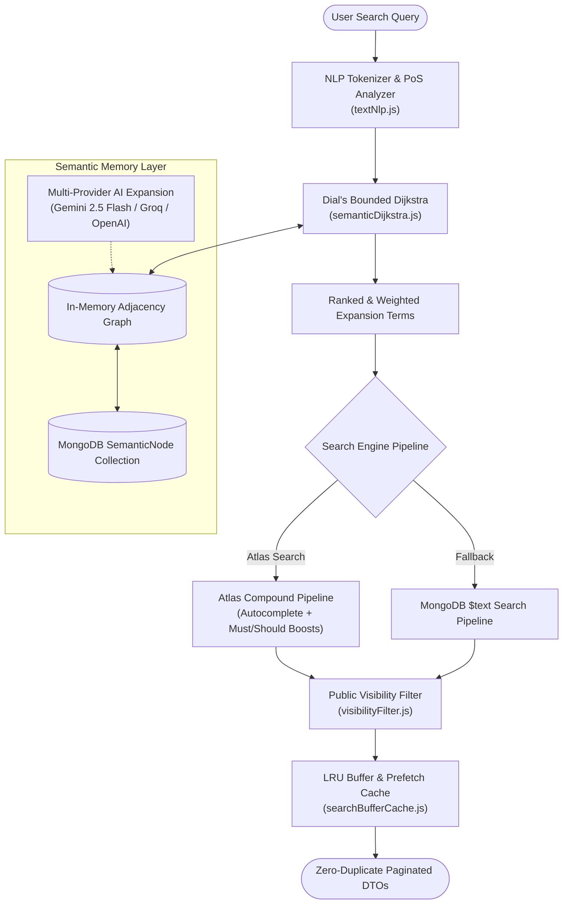

# 🌒 Eclipse Fantasy Semantic Search Engine

[](./backend/test/)
[](https://nodejs.org/)
[](https://www.mongodb.com/atlas/database)
[](./backend/src/services/aiGraphService.js)

A high-performance, deterministic semantic search engine and associative knowledge graph built specifically for fantasy, anime, and artistic wallpaper catalogs. 

Combines lightweight in-memory graph traversal (**Dial's Bounded Dijkstra**), **compromise** NLP tokenization, and **MongoDB Atlas Search** compound pipelines with a resilient multi-provider AI expansion fallback chain.

---

## 🌟 Key Architecture & Highlights



- **Graph-Powered Query Expansion**: Evaluates relationships across synonyms, hyponyms, hypernyms, siblings, moods, aesthetics, and scene descriptors.
- **Dial's Bounded Dijkstra (0..6 cost, max 2 hops)**: Deterministic, integer-bucket graph search with hop friction to prevent generic semantic drift.
- **Normalized LCS Typo Fallback**: Query words missing from the graph (typos, unseen words) are matched to the closest graph word using the Sørensen–Dice LCS score `2·LCS(A,B) / (|A|+|B|)`. DP uses pre-allocated `Uint8Array(64)` rows (no per-candidate heap allocation) with O(1) branch-and-bound pruning. A match with similarity ≥ 0.80 starts Dijkstra at cost 1, one with similarity 0.55–0.80 starts at cost 2, and anything lower is ignored.
- **Resilient AI Ingestion**: Multi-LLM provider fallback chain (`Gemini 2.5 Flash` → `Groq Llama-3.3-70b` → `OpenAI`) for building graph edges when new terms are introduced.
- **Zero-Downtime Draft Protection**: If AI expansion is temporarily unavailable upon wallpaper upload, wallpapers are cleanly staged in draft state with an asynchronous exponential-backoff retry worker.
- **Strict Public Visibility & DTO Projections**: Enforces status, deletion checks, and publish dates at the query level; sanitizes internal metadata from card payloads.
- **Atlas Search + Deterministic Fallback**: Native autocomplete edge-grams with seamless fallback to MongoDB `$text` search.

---

## 📁 Repository Structure

```
EclipseSearch/
├── .gitignore
├── README.md
└── backend/
    ├── docs/
    │   └── atlas-search.md             # MongoDB Atlas Search index definition
    ├── package.json
    ├── scripts/
    │   └── backfill-semantic-graph.js  # Batch utility to hydrate graph from DB
    ├── src/
    │   ├── models/
    │   │   ├── AiIngestionJob.js       # Background ingestion & retry schema
    │   │   └── SemanticNode.js         # Semantic graph persistence schema
    │   ├── services/
    │   │   ├── aiGraphService.js       # AI provider fallback & edge builder
    │   │   ├── memoryGraph.js          # In-memory graph representation
    │   │   ├── searchBufferCache.js    # LRU cache & pagination prefetch buffer
    │   │   ├── searchLifecycle.js      # Upload/edit/rename lifecycle hooks
    │   │   ├── searchRanking.js        # Search query scoring & boost builder
    │   │   ├── semanticDijkstra.js     # Dial's algorithm implementation
    │   │   ├── textNlp.js              # NLP parsing, singularize, stopwords
    │   │   └── wallpaperService.js     # Search execution & aggregation
    │   ├── utils/
    │   │   ├── visibilityFilter.js     # Public safety & status match filters
    │   │   └── wallpaperDTO.js         # Client-safe card data sanitization
    │   └── workers/
    │       └── draftRetryWorker.js     # Background retry queue processor
    └── test/
        ├── aiGraphService.test.js          # AI provider failover & edge sanitization (10 tests)
        ├── draftWorkerLifecycle.test.js    # Exponential backoff & lifecycle hooks (10 tests)
        ├── memoryGraph.test.js             # Directed weights & graph operations (10 tests)
        ├── searchBufferCache.test.js       # LRU eviction & TTL cache (8 tests)
        ├── searchRanking.test.js           # Atlas compound & $text fallback (12 tests)
        ├── semanticDijkstra.test.js        # Dial's algorithm, penalties & LCS typos (15 tests)
        ├── textNlp.test.js                 # Tokenization, singularization & stopwords (12 tests)
        ├── visibilityFilter.test.js        # Status & deletion safety filters (5 tests)
        ├── wallpaperDTO.test.js            # Security field stripping & projection (8 tests)
        └── wallpaperService.test.js        # Pagination, prefetching & deduplication (10 tests)
```

---

## 🚀 Getting Started

### 1. Prerequisites

- **Node.js**: `v18.0.0` or higher
- **MongoDB**: `v6.0+` (MongoDB Atlas recommended for Atlas Search autocomplete)

### 2. Installation

```bash
cd backend
npm install
```

### 3. Environment Configuration

Create a `.env` file inside `backend/`:

```env
PORT=5000
MONGODB_URI=mongodb+srv://<user>:<password>@cluster.mongodb.net/eclipsesearch
GEMINI_API_KEY=your_gemini_api_key
GROQ_API_KEY=your_groq_api_key
OPENAI_API_KEY=your_openai_api_key
```

---

## 🔍 Atlas Search Index Setup

For full-text autocomplete with edge-grams, configure the `wallpaper_search` index on your `wallpapers` collection in MongoDB Atlas:

```json
{
  "mappings": {
    "dynamic": false,
    "fields": {
      "title": [
        { "type": "string" },
        { "type": "autocomplete", "tokenization": "edgeGram", "minGrams": 2, "maxGrams": 15, "foldDiacritics": true }
      ],
      "tags": [
        { "type": "string" },
        { "type": "autocomplete", "tokenization": "edgeGram", "minGrams": 2, "maxGrams": 15, "foldDiacritics": true }
      ],
      "categoryName": { "type": "string" },
      "excerpt": { "type": "string" },
      "style": { "type": "string" },
      "story": { "type": "string" },
      "status": { "type": "token" },
      "deviceType": { "type": "token" },
      "publishAt": { "type": "date" },
      "views": { "type": "number" },
      "downloadsCount": { "type": "number" },
      "category": { "type": "objectId" }
    }
  }
}
```

---

## 🧪 Testing & Analysis Report

The test suite runs with Node's native test runner (`node --test`), requiring zero external test framework dependencies:

```bash
cd backend
npm test
```

### 📊 Test Suite Execution Summary

```
Total Tests:     100
Passed:          100
Failed:            0
Skipped:           0
Duration:     ~1,015 ms
Pass Rate:        100%
```

| Test Suite | Tests | Status | Target Component & Verification Focus |
|:---|:---:|:---:|:---|
| `testNlp.test.js` | 12 | ✅ PASS | NLP singularization (`-ies`, `-shes`, `-ches`, `-xes`), irregulars, general & domain stopwords, token normalization. |
| `memoryGraph.test.js` | 10 | ✅ PASS | Directed asymmetric weights (hyponym 2/4, hypernym 4/2), symmetric relations, self-loop pruning, 1..6 range clamp, graph rebuild & init. |
| `semanticDijkstra.test.js` | 15 | ✅ PASS | PoS miss penalties (noun 15, adjective 6, domain stopword 1), Dial's bucket queue, hop friction (+1 on hop 2), maxCost 6 & maxHops 2 cutoff, Sørensen–Dice LCS typo fallback (similarity ≥0.80 & 0.55..0.80). |
| `searchBufferCache.test.js` | 8 | ✅ PASS | LRU eviction ordering, TTL expiry eviction, cache hit promotion, generation incrementing, global singleton cache invalidation. |
| `wallpaperDTO.test.js` | 8 | ✅ PASS | Strict data protection: strips `story`, `downloadKeys`, `downloadBucket`, `uuid`, `downloads`, `conversionJournal`; safe category projection & URL fallbacks. |
| `visibilityFilter.test.js` | 5 | ✅ PASS | Strict draft rejection (`status: { $ne: 'draft' }`), deletion pending check (`deletionPending: { $ne: true }`), publish date validation. |
| `searchRanking.test.js` | 12 | ✅ PASS | Primary weights (title 10, tags 8, categoryName 7), Atlas compound pipeline with `minimumShouldMatch: 1`, fuzzy edge-gram autocomplete, deterministic sort, MongoDB `$text` fallback failover. |
| `wallpaperService.test.js` | 10 | ✅ PASS | Multi-page traversal with **zero duplicate IDs**, prefetch buffer activation at threshold (<25 remaining), buffer expansion for jump pages, device-isolated cache partitions. |
| `aiGraphService.test.js` | 10 | ✅ PASS | Structured LLM prompt generation, edge sanitization, weight clamping, multi-provider failover chain, unseen word deduplication, safe draft fallback on total provider failure. |
| `draftWorkerLifecycle.test.js` | 10 | ✅ PASS | Exponential backoff progression (2m, 4m, 8m ... max 60m), atomic pending job claiming, wallpaper publication on retry, permanent failure ceiling after 10 attempts, lifecycle edit hooks. |

---

## 🛠️ Graph Hydration & Backfill

To seed or backfill the semantic graph from existing wallpaper data in your database:

```bash
cd backend
npm run backfill:semantic
```

---

## ⚖️ License

Private project developed for Eclipse Fantasy. All rights reserved.
