# Eclipse Fantasy — Semantic Search Engine

[](./backend/test/)
[](https://nodejs.org/)
[](https://www.mongodb.com/atlas/database)
[](#concurrency-ladder-1k--20k-concurrent-searches)
[](#real-http-load-testing-autocannon-on-atlas-schema-10k-catalog)
[](#benchmark-scope--methodology)
[](#search-relevance-results)

A deterministic semantic search engine and associative knowledge graph for fantasy, anime and artistic wallpaper catalogs.

**Graph traversal happens only when the graph is written — never while serving a search.** Hop-bounded shortest-path traversal runs at write time and its results go into a flat, `TypedArray`-backed top-K neighbor index. At query time, expanding a search is a set of array lookups. In-flight requests are coalesced (singleflight). Pagination preserves a per-session ranked pool. Live mode hydrates each page from MongoDB to recheck visibility; demo mode slices cached rows.

> [!IMPORTANT]
> **All performance figures in this document are origin-only.** They were measured **without the Cloudflare edge cache** ([`searchCacheWorker.js`](./backend/src/edge/searchCacheWorker.js)), without any CDN, Redis or other external cache layer, and on a single Node.js process. In production, cacheable public queries are answered at the edge before they reach the origin, so these are observations for the stated fixtures and runtimes. They do not establish production latency or capacity.

---

## Table of Contents

1. [System Architecture](#system-architecture)
2. [How the Engine Works](#how-the-engine-works)
3. [Optimisation Techniques](#optimisation-techniques)
4. [Test Suite & Results](#test-suite--results)
5. [Performance & Load Testing](#performance--load-testing)
6. [Repository Structure](#repository-structure)
7. [Getting Started](#getting-started)
8. [Atlas Search Index](#atlas-search-index)
9. [Operational Notes & Known Limits](#operational-notes--known-limits)

---

## System Architecture

The system has two paths. The **write path** (upload, AI ingestion, backfill) pays all the computational cost up front. The **read path** (search) does only lookups and slices.

```mermaid
flowchart LR
    subgraph EDGE["Edge (not part of benchmarks)"]
        CF["Cloudflare Worker<br/>query normalisation + Cache API"]
    end

    subgraph READ["Read Path - search, hot"]
        direction TB
        API["GET /api/search"] --> SESS{"sessionId<br/>in LRU?"}
        SESS -->|yes| SLICE["Slice ranked pool<br/>cursor + Set dedupe"]
        SESS -->|no| NLP["analyzeQuery<br/>compromise PoS + stopwords"]
        NLP --> EXP["NeighborIndex.expand<br/>TypedArray lookups, zero traversal"]
        EXP --> TYPO["Typo fallback, max 2 tokens<br/>bitmask prefilter, LCS, LRU cache"]
        TYPO --> CUT["Relevance cutoff<br/>boost >= MIN_BOOST"]
        CUT --> SF["Singleflight<br/>coalesce identical in-flight keys"]
        SF --> DB[("MongoDB Atlas Search<br/>compound pipeline / $text fallback")]
        DB --> POOL["Ranked pool, 200 rows<br/>stored in session"]
        POOL --> SLICE
        SLICE --> DTO["wallpaperCardDTO<br/>strip internal fields"]
    end

    subgraph WRITE["Write Path - ingestion, cold"]
        direction TB
        UP["Upload / Edit / Backfill"] --> AI["AI expansion chain<br/>Gemini, Groq, OpenAI"]
        AI --> PERSIST["bulkWrite SemanticNode<br/>+ addEdges to memoryGraph"]
        PERSIST --> DIJ["Hop-bounded traversal<br/>Exact-hop frontiers, cost 6, 2 hops"]
        DIJ --> IDX["NeighborIndex.update<br/>affected region only"]
        AI -.->|all providers down| DRAFT["Draft + exponential backoff worker"]
    end

    CF --> API
    IDX -.->|precomputed top-K| EXP
```



---

## How the Engine Works

### 1. Query understanding — [`textNlp.js`](./backend/src/services/textNlp.js), [`semanticDijkstra.js`](./backend/src/services/semanticDijkstra.js)

The query is tokenised, normalised (lower-case, symbols and emoji stripped; internal hyphens are kept, so `sci-fi` is emitted as both `sci-fi` and `scifi`), singularised (`fairies → fairy`, `witches → witch`, and irregular forms) and filtered for stopwords. `compromise` tags each surviving token with a part of speech. The tag sets the **miss penalty** applied when a candidate term is unrelated to that token:

| Token class | Miss penalty | Rationale |
|:---|:---:|:---|
| Entity / noun | 15 | The subject of the search. Missing it makes the result irrelevant. |
| Modifier / adjective | 6 | Refines the result. A miss costs relevance but is not disqualifying. |
| Domain stopword | 1 | Words like *wallpaper* or *background* carry almost no signal. |

### 2. Semantic graph and write-time precomputation — [`memoryGraph.js`](./backend/src/services/memoryGraph.js), [`neighborIndex.js`](./backend/src/services/neighborIndex.js)

The knowledge graph stores typed, weighted relations: synonym, hyponym, hypernym, sibling, scene, mood and tangent. Some weights are **asymmetric**. For example, *dragon → wyvern* (hyponym) is cheaper than the reverse direction, so specific queries do not drift towards generic terms.

When a word is added or edited, `NeighborIndex.update(graph, changedWords)`:

1. Runs a BFS outward from the changed words for `MAX_HOPS = 2` hops. These are the only nodes whose shortest paths can have changed.
2. Runs **shortest paths with a separate frontier per exact hop count** (integer edge weights 1..6, +1 friction on hop 2) from each affected node.
3. Writes the cheapest `K = 20` neighbors into flat buffers:

```text
neighborNodeIds[node * K + i]   Uint32   neighbor node id
neighborCosts  [node * K + i]   Uint8    semantic cost (0..6)
neighborCounts [node]           Uint8    occupied slots (<= K)
```

Buffers grow by doubling, which amortises the cost of growth to O(1). At startup, `initMemoryGraph()` hydrates the graph from MongoDB and builds the index once.

### 3. Query expansion with zero traversal

`NeighborIndex.expand(q)` reads each token's precomputed neighbor list and builds the union of candidate terms. Each candidate's cost is the **minimum**, over the query tokens, of either its precomputed distance or that token's miss penalty. A term only has to be close to *one* query token to be relevant — for multi-word queries such as `dragon knight`, whose tokens have disjoint neighborhoods, this ensures both token neighborhoods contribute candidates without inflating costs. Candidates are sorted by cost and the top 25 are kept. `boostFor(cost)` converts each cost into an Atlas boost. **No graph traversal happens per request.**

**Typo fallback.** A token that is not in the vocabulary (at most 2 per query) is matched to the closest dictionary word using the Sørensen–Dice LCS similarity `2·LCS(A,B) / (|A|+|B|)`:

- similarity ≥ 0.80: the match's neighbors are inherited at **+1** cost
- 0.55 ≤ similarity < 0.80: inherited at **+2** cost
- similarity < 0.55: ignored, and the token's normal miss penalty applies

### 4. Retrieval and ranking — [`searchRanking.js`](./backend/src/services/searchRanking.js)

Expanded terms are compiled into an **Atlas Search compound pipeline**. Primary fields are weighted title 10, tags 8, categoryName 7, wrapped in a `must` clause with `minimumShouldMatch: 1`. Edge-gram fuzzy autocomplete covers partially typed queries. Secondary fields add `should` boosts. Sorting is deterministic. If Atlas Search is unavailable, the engine falls back to a MongoDB `$text` query. [`visibilityFilter.js`](./backend/src/utils/visibilityFilter.js) applies the public visibility rules (no drafts, no pending deletions, `publishAt <= now`) **inside the query itself**, not as a post-filter.

### 5. Progressive pagination — [`progressiveSearch.js`](./backend/src/services/progressiveSearch.js)

```text
Request 1 (no sessionId)
  expand -> drop terms with boost < 2 -> singleflight(fetchPool, limit 200)
  -> optional score-ratio cutoff -> store {ranked, cursor, seenIds:Set} in LRU (5,000 sessions, 15 min TTL)
  -> return first 20 + sessionId

Request 2..N (with sessionId)
  -> advance cursor over the in-memory ranked pool, skip ids already in seenIds
  -> return next 20, hasMore = cursor < ranked.length       (demo mode: no DB round-trip)
```

In live mode, Atlas ranks the initial pool and the session stores document IDs.
Each page hydrates its IDs from MongoDB, preserving rank and excluding wallpapers
that have since become drafts, pending deletion, or scheduled for the future.
The initial Atlas query returns only IDs and scores, without category population.

For numbered pagination, send `q`, `page` and a constant `limit` from page 1 onward.
Each numbered page addresses a fixed window of unique ranked IDs and hydrates only
that window: page 10 does not fetch pages 1–9. Withdrawals can leave short or empty
pages; check `hasMore`, rather than page length, before stopping. Numbered
`totalPages` counts rank windows. The visible `total` stays `unknown` until a
session has traversed the whole pool; a cold jump cannot establish that count.
Without `sessionId`, each request ranks a fresh pool (one ranking operation plus
one hydration query, with a text fallback if Atlas fails). Changes to ranking or
visibility between independent requests can shift results. Use the private session
for a stable ranked pool. Omitting `page` advances the cursor and refills filtered
pages; choose that mode from the first request when full pages are required.

### 6. Write-path resilience — [`aiGraphService.js`](./backend/src/services/aiGraphService.js), [`draftRetryWorker.js`](./backend/src/workers/draftRetryWorker.js)

The engine uses AI only to discover new words, never during a search. Upload
processing makes one fallback pass through the configured providers (Gemini 2.5
Flash, Groq Llama-3.3-70B and OpenAI), persisting partial expansions. It does not
sleep or repeat that pass in the request. The initial pass can still wait up to
about 30 seconds with three providers at their 10-second timeouts, plus database
and graph work; this is not a fully asynchronous upload API.

Missing expansions or provider failures return **draft** status and
`unprocessedWords`. The integrating upload handler must save the wallpaper with
that status and call `queueDraftJob` after saving; this drop-in repository does
not contain an upload route. The background worker retries only missing words
with persisted backoff (2 m → 4 m → 8 m … capped at 60 m, abandoned after 10
attempts), then restores the requested published or scheduled status.

---

## Optimisation Techniques

| # | Technique | Where | Why it matters |
|:-:|:---|:---|:---|
| 1 | **Read/write split** (precompute at write time) | `neighborIndex.js` | Writes are rare and reads are frequent, so the expensive traversal moves to the rare side. |
| 2 | **Struct-of-arrays in `TypedArray`s** | `neighborIndex.js` | Cache-friendly sequential reads and no per-node heap objects for V8's GC to scan. 10k nodes × K=20 take about **1.6 MB**. |
| 3 | **Incremental, region-bounded updates** | `NeighborIndex.update` | Only nodes within 2 hops of a change are recomputed. A full rebuild is needed only at startup or backfill. |
| 4 | **Exact-hop frontiers** | `semanticDijkstra.js` | Separate distance states for each hop count preserve viable short paths; terminal states need no expansion. |
| 5 | **Hop friction + cost ceiling** | `semanticDijkstra.js` | Prevents *dragon → animal → cat* style drift and bounds the search space. |
| 6 | **Disjoint alphabet prefilter** | `findClosestWordByNormalizedLCS` | Disjoint a–z masks reject impossible matches. Shared-character counts are not a safe LCS bound when letters repeat. |
| 7 | **Branch-and-bound on length** | `findClosestWordByNormalizedLCS` | Skips any candidate whose best possible score cannot match the current best; equal scores remain eligible for lexical tie-breaking. |
| 8 | **Compact DP rows** | `lcsLength` | Uses two `Uint8Array` rows allocated per comparison. |
| 9 | **Negative caching** | LRU `typoCache` (5,000) | Misses are stored as a `NO_MATCH` sentinel, so repeated garbage queries cost O(1). |
| 10 | **Typo budget** (`MAX_TYPO_TOKENS = 2`) | expansion | Limits CPU per request, which mitigates algorithmic-complexity DoS. |
| 11 | **Singleflight request coalescing** | `singleflight.js` | Prevents a thundering herd on hot or trending queries. N concurrent callers produce one fetch. |
| 12 | **Order-insensitive keys** | `searchKey` / `normalizeQuery` | `"Red Dragon"` and `"dragon red"` coalesce and share a cache entry. |
| 13 | **Session-scoped ranked pools** | `progressiveSearch.js` | Reuses ranking across pages; live pages hydrate IDs and recheck visibility. Deduplication uses an O(1) `Set`. |
| 14 | **Relevance cutoffs** | `MIN_BOOST`, `minScoreRatio` | Stops paginating into noise and makes the result pool smaller. |
| 15 | **Query-level visibility** | `visibilityFilter.js` | The database never returns ineligible rows, so no work is spent filtering them afterwards. |
| 16 | **DTO projection** | `wallpaperDTO.js` | Removes `story`, `downloadKeys`, `uuid` and similar fields, which keeps payloads small and private data off the wire. |
| 17 | **Edge normalisation + SWR** | `searchCacheWorker.js` | Serves repeat public queries at the edge. *Disabled for all benchmarks below.* |

---

## Test Suite & Results

The suite uses Node's built-in test runner (`node --test`). It has no external test-framework dependencies.

```bash
cd backend
npm test
```

### Execution summary

Verified on **2026-10-21**, for the pagination/cache/upload corrections based on [commit `c583dc6`](https://github.com/kanaboina/EclipseSearch/commit/c583dc6a087b088723572289c62ccfb872eb17aa), using **Node.js v24.21.0**, **npm 11.19.0**, and **Ubuntu 26.04.1**.

```text
Command:         npm test --prefix backend  (from repository root)
Test files:       23
Total tests:     260
Passed:          260
Failed:            0
Cancelled:         0
Skipped:           0
Pass rate:      100%
Runner duration: 5.885 s
```

This audit adds **33 regression tests**: 30 in `bugAudit.test.js` and 3 in `edgeWorker.test.js`, alongside the earlier 21 regressions. The follow-up adds 10 tests in `continuationRegression.test.js` for constant hydration cost, fixed page boundaries, retry handoff and cache continuation. Counts include the server lifecycle parent test and its 9 subtests. Durations are observations from this run, not performance guarantees.

The first full follow-up run failed an existing hub-traversal maximum-time gate (17.183 ms versus 10 ms). The isolated latency suite and the full rerun passed without changing code or thresholds.

The suite exercises a generated catalog, synthetic AI provider responses, MongoDB model/collection fixtures, an HTTP server, and a simulated Worker Cache API. It does **not** verify a live Atlas cluster, real AI providers, or a deployed Cloudflare Worker. Live Atlas verification requires a configured compatible database.

### Coverage by suite

| Suite | Tests | Status | Verification focus |
|:---|:---:|:---:|:---|
| `textNlp.test.js` | 12 | ✅ | Singularisation (`-ies`, `-shes`, `-ches`, `-xes`, irregulars), general and domain stopwords, token normalisation (internal hyphens preserved) |
| `memoryGraph.test.js` | 14 | ✅ | Asymmetric hyponym/hypernym weights, symmetric relations, self-loop pruning, 1..6 weight filtering, rebuild and init |
| `semanticDijkstra.test.js` | 15 | ✅ | PoS penalties (15 / 6 / 1), Bounded traversal, hop friction, cost and hop cutoffs, LCS typo tiers (≥0.80, 0.55–0.80) |
| `searchBufferCache.test.js` | 8 | ✅ | LRU ordering, TTL expiry, hit promotion, generation-based invalidation |
| `wallpaperDTO.test.js` | 8 | ✅ | Strips internal and sensitive fields, safe category projection, URL fallbacks |
| `visibilityFilter.test.js` | 5 | ✅ | Draft rejection, deletion-pending exclusion, publish-date gating |
| `searchRanking.test.js` | 12 | ✅ | Field weights, compound pipeline with `minimumShouldMatch: 1`, fuzzy autocomplete, `$text` failover |
| `wallpaperService.test.js` | 10 | ✅ | Multi-page traversal with zero duplicates, prefetch threshold, jump pages, device-isolated partitions |
| `aiGraphService.test.js` | 14 | ✅ | Prompt structure, edge sanitisation, weight clamping, provider failover, safe draft fallback |
| `draftWorkerLifecycle.test.js` | 10 | ✅ | Backoff progression, atomic job claiming, retry publication, 10-attempt ceiling, edit hooks |
| `latencyMetrics.test.js` | 8 | ✅ | Latency SLA regression gates over a 10,000-word search space |
| `highPerfSearch.test.js` | 13 | ✅ | TypedArray layout, K-cap, live-vs-precomputed parity, singleflight, session deduplication, single-fetch pagination, relevance cutoff, key normalisation, bitmask/popcount, typo cache identity, typo budget, incremental 2-hop refresh |
| `stress.test.js` | 5 | ✅ | 10k-word index build, sustained expansion rate, 2k-way coalescing, 3k concurrent sessions, 10k-token adversarial query plus typo storm |
| `server.test.js` | 10 | ✅ | Full HTTP integration: health endpoint, search with query, pagination via sessionId, 400 on missing query, 404 on unknown route, deviceType filtering, custom limit, response headers |
| `mockAtlasData.test.js` | 9 | ✅ | 10k catalog generation (schema fields, unique IDs, token index integrity), Atlas simulator scoring, deviceType filter, excludeIds, DTO projection on results |
| `singleflight.test.js` | 5 | ✅ | Error propagation to all waiters, independent key isolation, key reuse after completion, pending count accuracy, synchronous value coalescing |
| `neighborIndex.test.js` | 12 | ✅ | size/has/byteLength properties, neighbors (self, unknown word), expand (empty, multi-word, custom limit, cost ordering), build chaining, capacity doubling, resolveDocIds multi-word score aggregation |
| `progressiveSearch.test.js` | 10 | ✅ | searchKey edge cases (null, falsy, whitespace), exported constants, empty pool in legacy and ID-first mode, custom batchSize, session isolation, doc reordering, session introspection |
| `edgeCases.test.js` | 16 | ✅ | Lifecycle cache invalidation, expandQuerySemantically edge cases (empty, unknown, multi-word, TOP_TERMS cap), charMask/popcount boundaries, analyzeQuery hyphens and emoji, normalizeTokenStrict, dataset generator validation |
| `prRegression.test.js` | 17 | ✅ | Complete pagination, hydration retries, concurrent sessions, semantic retrieval, live visibility, model registration, partial expansion persistence, draft retries, persisted unlinking, backfill accounting, totals, and HTTP input/error boundaries |
| `edgeWorker.test.js` | 7 | ✅ | Session-free cached first pages, stateless continuation, ignoring obsolete cached pages, non-JSON forwarding, cache flags, origin URL joining, and cache failures |

| `continuationRegression.test.js` | 10 | ✅ | Cold page query counts, withdrawal boundaries, hydration retries, totals, ID-only Atlas/text ranking, upload-to-worker retries and cached HTTP continuation |
| `bugAudit.test.js` | 30 | ✅ | Capacity growth, exhaustive bounded-path/scoring comparisons, typo pruning and invalidation, explicit/replayed pages, expired/mismatched sessions, invalid IDs/URLs/weights, async timing, patch edits, worker batching/status, cache retries/races, and script behavior |

### Stress test results (10,000-word synthetic graph)

These results are from the same 260-test run above. **Test duration** is the Node test runner's duration for the entire test, including fixtures and assertions; it is not an isolated operation latency or a throughput measurement.

| ID | Scenario | Passing assertions | Test duration (ms) | Result |
|:---:|:---|:---|---:|:---:|
| S1 | Build `NeighborIndex` (K=15) over 10k words | Internal build < 3,000 ms; sampled nodes have ≤ 15 neighbors | 232.77 | ✅ |
| S2 | 5,000 sequential `expand()` calls across the vocabulary | > 1,000 expansions/s; each expansion returns terms | 693.03 | ✅ |
| S3 | 2,000 concurrent identical searches | Exactly 1 pool fetch; every caller gets 20 rows; `pending = 0` | 412.36 | ✅ |
| S4 | 3,000 concurrent users × 3 pages (9,000 searches) | 3,000 unique session IDs; zero duplicates; > 1,000 searches/s | 653.58 | ✅ |
| S5 | 10,000-token query + 1,000 repeated typo lookups | Internal expansion < 10 s; repeated typo lookups return the same cached result | 301.02 | ✅ |

> [!NOTE]
> S5 calls the traversal-based `expandQuerySemantically` function directly with all 10,000 vocabulary words. Its full test duration was 0.451 s in the 8.634 s suite run. Term scoring groups equal absence penalties for large queries and retains only the requested top terms. The HTTP API rejects queries longer than 500 characters or 20 whitespace-delimited tokens.

---

## Performance & Load Testing

### Benchmark scope & methodology

The concurrency ladder and HTTP load sections retain historical measurements; they were not rerun for this audit. The component benchmark was rerun with completed asynchronous operations on Node.js v24.21.0. The older load runs used different code, runtimes and fixtures.

| Parameter | Value |
|:---|:---|
| Runtime | Node.js v26.8.1, Linux x64, **single process / single event loop** |
| Search space | 10,000 words, synthetic deterministic graph |
| Timer | `process.hrtime.bigint()` (nanosecond resolution), JIT warm-up before sampling |
| **CDN / edge cache** | ❌ **Disabled — no Cloudflare cache** |
| External caches | ❌ None (no Redis or Memcached). Only in-process LRU caches are active. |
| Clustering | ❌ None (no `cluster`, PM2 or horizontal replicas) |
| Database I/O | Mocked in-memory `fetchPool` (100 rows) to isolate application-layer cost |

> [!WARNING]
> Because the database is mocked, these numbers measure the **engine's own overhead**: NLP, expansion, coalescing, sessions and slicing. Live mode ranks the initial pool through Atlas and hydrates each page from MongoDB to recheck visibility. Those database round trips are not measured by the in-process ladder. The edge worker caches public first pages without session IDs and supplies a `nextPage` URL; later pages and private sessions bypass its cache.

### Concurrency ladder (1k → 20k concurrent searches)

[`scripts/concurrency-ladder.js`](./backend/scripts/concurrency-ladder.js) fires *N* searches at once through `Promise.all`, increasing *N* from 1,000 to 20,000 in 20 steps. The traffic mix is **60% hot queries** (5 trending terms, which exercises singleflight) and **40% long-tail queries** (distinct words spread across the vocabulary). Raw output is in [`concurrency-ladder-results.json`](./backend/concurrency-ladder-results.json). *Last run: 2026-10-20, Node v26.8.1, 12 logical cores, run with `--expose-gc`.*

| Test | Concurrency | Batch time (ms) | Throughput (QPS) | Mean (ms) | p50 (ms) | p90 (ms) | p95 (ms) | p99 (ms) | Max (ms) | Heap (MB) |
|:---:|---:|---:|---:|---:|---:|---:|---:|---:|---:|---:|
| 1 | 1,000 | 77.51 | 12,901 | 29.21 | 28.53 | 49.26 | 52.27 | 55.66 | 77.20 | 27.3 |
| 2 | 2,000 | 127.12 | 15,733 | 64.69 | 63.09 | 114.99 | 120.60 | 124.80 | 126.75 | 60.4 |
| 3 | 3,000 | 149.79 | 20,028 | 79.52 | 76.79 | 134.77 | 141.84 | 147.53 | 149.32 | 56.2 |
| 4 | 4,000 | 182.84 | 21,876 | 95.82 | 94.21 | 162.61 | 171.38 | 179.61 | 182.15 | 63.9 |
| 5 | 5,000 | 216.58 | 23,086 | 116.06 | 114.73 | 194.28 | 204.74 | 213.09 | 215.76 | 71.7 |
| 6 | 6,000 | 253.59 | 23,660 | 127.76 | 122.37 | 219.56 | 234.43 | 247.71 | 252.61 | 93.9 |
| 7 | 7,000 | 312.09 | 22,429 | 167.84 | 166.33 | 282.33 | 296.44 | 307.35 | 310.98 | 96.1 |
| 8 | 8,000 | 343.16 | 23,313 | 177.89 | 173.64 | 297.90 | 315.26 | 331.89 | 342.05 | 103.0 |
| 9 | 9,000 | 428.32 | 21,013 | 223.93 | 212.18 | 381.06 | 402.89 | 421.78 | 427.24 | 115.9 |
| 10 | 10,000 | 391.81 | 25,522 | 213.47 | 209.31 | 350.51 | 369.85 | 385.23 | 390.57 | 122.5 |
| 11 | 11,000 | 426.54 | 25,789 | 227.81 | 224.19 | 378.68 | 400.10 | 417.22 | 423.07 | 139.1 |
| 12 | 12,000 | 503.62 | 23,827 | 265.02 | 260.09 | 442.80 | 470.01 | 492.78 | 501.69 | 136.3 |
| 13 | 13,000 | 476.16 | 27,302 | 253.18 | 250.16 | 420.37 | 446.08 | 467.54 | 474.36 | 151.2 |
| 14 | 14,000 | 513.28 | 27,276 | 276.32 | 272.02 | 457.83 | 483.14 | 505.06 | 512.02 | 151.6 |
| 15 | 15,000 | 594.68 | 25,224 | 310.68 | 301.56 | 524.39 | 555.13 | 582.12 | 591.35 | 163.0 |
| 16 | 16,000 | 592.08 | 27,023 | 314.01 | 307.92 | 521.93 | 552.19 | 577.58 | 586.08 | 156.7 |
| 17 | 17,000 | 610.33 | 27,854 | 324.49 | 317.92 | 539.35 | 571.53 | 598.69 | 608.22 | 179.1 |
| 18 | 18,000 | 666.61 | 27,002 | 348.35 | 340.17 | 585.39 | 621.74 | 653.70 | 664.50 | 185.4 |
| 19 | 19,000 | 672.24 | 28,264 | 360.37 | 356.09 | 597.54 | 631.55 | 660.57 | 669.63 | 186.0 |
| **20** | **20,000** | 705.07 | **28,366** ⬆ | 370.95 | 365.83 | 620.62 | 654.91 | 688.67 | 702.12 | 199.7 |

#### Headline numbers

| Metric | Value |
|:---|:---|
| Peak throughput (single process, **no edge cache**) | **28,366 QPS** at 20k concurrency |
| Sustained throughput plateau (≥ 13k concurrency) | **25–28k QPS** |
| Effective per-search CPU cost | **≈ 35 µs** (1 / 28.4k QPS) |
| 20,000 simultaneous searches drained in | **705 ms** |
| Errors / dropped requests across all 210,000 searches | **0** |
| Heap at 20k concurrency (20k live sessions with pools) | ~200 MB |

#### Reading the curve

- **Throughput scales, then plateaus.** QPS rises from 12.9k to 23k between 1k and 5k concurrency as V8 warms up and fixed per-batch overhead is amortised. It then climbs more slowly and settles at **25–28k QPS** from 13k concurrency upwards. This is the CPU ceiling of **one** event loop. Throughput never collapses as load increases, which means there is no lock contention, quadratic behaviour or GC thrashing. The dips at 7k, 9k and 12k are run-to-run noise (GC pauses landing inside a batch).
- **Latency here is queueing time, not service time.** All *N* requests are released in the same tick, so the last request waits for the N−1 ahead of it. That is why p99 ≈ batch duration and latency grows linearly with *N*. The actual service time is **~35 µs per search**. Against a real arrival process (Poisson rather than a burst), tail latency is far lower at the same QPS.
- **Heap is bounded.** Memory follows the number of live sessions (each holds a ranked pool and a `Set`), not request count. It grows roughly linearly from 27 MB to 200 MB, about 10 KB per live session. The production session LRU is capped at 5,000 entries with a 15-minute TTL.
- **Run-to-run variance.** An earlier run on the same machine peaked at 31.3k QPS. Expect about ±10% between runs depending on background load and GC timing.
- **Linear horizontal scaling.** The engine is stateless apart from session affinity, so `cluster` across *C* cores, or *R* replicas behind sticky routing, multiplies the plateau by roughly *C × R*. That figure is **before** counting edge-cache offload.

### Component micro-benchmarks (10,000-word search space)

Measured on **2026-10-20**, Node.js **v24.21.0**, with the corrected async runner in [`scripts/benchmark-10k.js`](./backend/scripts/benchmark-10k.js). The [JSON snapshot](./backend/test-metrics-10k.json) contains 41 operations, 10,000 vocabulary words, 10,002 graph nodes and 115,744 adjacency entries. Service and ingestion timings include completed promises; database calls use synthetic in-process models. Typo rows measure warm LRU lookups after warmup, including the cached miss. No real database/provider latency is measured.

| Function / process | Category | Samples | Mean (ms) | P50 (ms) | P95 (ms) | P99 (ms) | Max (ms) |
|:---|:---|---:|---:|---:|---:|---:|---:|
| `singularize (regular plural - dragons)` | NLP | 200 | 1.1712 | 1.0500 | 1.6534 | 2.6832 | 4.6416 |
| `singularize (irregular -ies - fairies)` | NLP | 200 | 1.1184 | 0.9147 | 1.5942 | 2.4414 | 3.4958 |
| `singularize (irregular -ches - witches)` | NLP | 200 | 0.9413 | 0.9130 | 1.1578 | 1.6084 | 2.1822 |
| `singularize (non-singular -ss - abyss)` | NLP | 200 | 0.6893 | 0.6696 | 0.7931 | 1.2613 | 1.3262 |
| `singularize (short/num - 4k)` | NLP | 200 | 0.0005 | 0.0003 | 0.0006 | 0.0011 | 0.0138 |
| `normalizeToken (clean token)` | NLP | 1000 | 0.0006 | 0.0005 | 0.0008 | 0.0011 | 0.0223 |
| `normalizeToken (noisy symbols/emoji)` | NLP | 1000 | 0.0009 | 0.0008 | 0.0011 | 0.0017 | 0.0209 |
| `extractCleanWords (standard wallpaper doc)` | NLP | 100 | 21.4564 | 21.3373 | 23.0924 | 27.1251 | 27.1251 |
| `extractCleanWords (dense wallpaper doc)` | NLP | 100 | 35.0216 | 34.9931 | 36.1165 | 36.3978 | 36.3978 |
| `analyzeQuery (1-word entity: dragon)` | NLP | 100 | 0.7727 | 0.7593 | 0.8530 | 1.3743 | 1.3743 |
| `analyzeQuery (3-word query: dark dragon castle)` | NLP | 100 | 2.2156 | 2.1780 | 2.4328 | 2.9640 | 2.9640 |
| `analyzeQuery (6-word noisy query with stopwords)` | NLP | 100 | 5.9864 | 5.8146 | 7.0994 | 8.6501 | 8.6501 |
| `rebuildGraph (hydrate all 10,000 nodes)` | MemoryGraph | 25 | 30.4315 | 29.5077 | 36.1244 | 40.3299 | 40.3299 |
| `addEdges (insert 5 edges into 10k graph)` | MemoryGraph | 500 | 0.0008 | 0.0006 | 0.0009 | 0.0019 | 0.0391 |
| `directedWeights (hyponym forward/reverse)` | MemoryGraph | 1000 | 0.0003 | 0.0003 | 0.0004 | 0.0006 | 0.0177 |
| `directedWeights (symmetric weight)` | MemoryGraph | 1000 | 0.0003 | 0.0003 | 0.0004 | 0.0006 | 0.0151 |
| `Bounded traversal (dragon, degree 265)` | Dijkstra | 200 | 0.5158 | 0.4707 | 0.7364 | 1.0560 | 1.1760 |
| `Bounded traversal (starblade, degree 17)` | Dijkstra | 500 | 0.0210 | 0.0203 | 0.0237 | 0.0377 | 0.0535 |
| `Bounded traversal (darkness, degree 1)` | Dijkstra | 500 | 0.0007 | 0.0006 | 0.0010 | 0.0013 | 0.0209 |
| `findClosestWordByNormalizedLCS (cached typo: dragn)` | LCS | 50 | 0.0011 | 0.0009 | 0.0017 | 0.0045 | 0.0045 |
| `findClosestWordByNormalizedLCS (cached typo: castlee)` | LCS | 50 | 0.0012 | 0.0008 | 0.0014 | 0.0204 | 0.0204 |
| `findClosestWordByNormalizedLCS (cached miss: zzzzzzzz)` | LCS | 30 | 0.0008 | 0.0007 | 0.0010 | 0.0015 | 0.0015 |
| `expandQuerySemantically (1-word exact: dragon)` | Expansion | 50 | 1.7308 | 1.7112 | 1.9103 | 2.6831 | 2.6831 |
| `expandQuerySemantically (3-word multi-source: dragon knight castle)` | Expansion | 50 | 5.5863 | 5.4410 | 6.3601 | 6.8980 | 6.8980 |
| `expandQuerySemantically (typo + exact: dragn knight)` | Expansion | 30 | 3.6448 | 3.6032 | 3.7934 | 4.2500 | 4.2500 |
| `boostFor (cost-to-boost curve)` | Ranking | 1000 | 0.0003 | 0.0003 | 0.0004 | 0.0007 | 0.0347 |
| `buildAtlasPipeline (with precomputed expansion)` | Ranking | 500 | 0.0301 | 0.0232 | 0.0568 | 0.0741 | 0.1286 |
| `buildAtlasPipeline (with 10k precomputed neighbor index)` | Ranking | 30 | 2.3220 | 2.3086 | 2.4994 | 2.7109 | 2.7109 |
| `buildTextFallbackQuery` | Ranking | 1000 | 0.0019 | 0.0018 | 0.0022 | 0.0091 | 0.0545 |
| `publicVisibilityFilter` | Utils | 1000 | 0.0005 | 0.0005 | 0.0007 | 0.0011 | 0.0178 |
| `SearchBufferCache.set` | Cache | 1000 | 0.0006 | 0.0006 | 0.0008 | 0.0014 | 0.0252 |
| `SearchBufferCache.get (hit)` | Cache | 1000 | 0.0005 | 0.0005 | 0.0006 | 0.0009 | 0.0279 |
| `SearchBufferCache.get (miss)` | Cache | 1000 | 0.0003 | 0.0002 | 0.0004 | 0.0005 | 0.0119 |
| `SearchBufferCache.set under eviction pressure (>200 keys)` | Cache | 500 | 0.0008 | 0.0008 | 0.0011 | 0.0021 | 0.0247 |
| `wallpaperCardDTO (single card)` | DTO | 1000 | 0.0007 | 0.0006 | 0.0009 | 0.0013 | 0.0146 |
| `wallpaperCardDTO (batch 50 cards mapping)` | DTO | 200 | 0.0084 | 0.0033 | 0.0212 | 0.0391 | 0.6675 |
| `searchService.search (cold query - cache miss)` | Service | 100 | 0.0315 | 0.0278 | 0.0503 | 0.0871 | 0.0871 |
| `searchService.search (warm query - cache hit)` | Service | 500 | 0.0023 | 0.0020 | 0.0027 | 0.0109 | 0.0229 |
| `searchService.search (page 2 - buffered slice)` | Service | 500 | 0.0022 | 0.0020 | 0.0026 | 0.0064 | 0.0309 |
| `sanitizeExpansions (3 words x 25 raw edges)` | Ingestion | 500 | 0.0178 | 0.0156 | 0.0317 | 0.0421 | 0.0852 |
| `findUnseenWords (filter 50 words vs 10k database)` | Ingestion | 200 | 0.4181 | 0.4132 | 0.4433 | 0.4776 | 0.4852 |

The traversal rows describe write-time work for the precomputed index. The expansion rows call the traversal-based comparison function directly. `BENCHMARK_OUTPUT=/path/report.json` selects an alternate report path.

### Running the benchmarks

```bash
cd backend

npm test                              # full suite: unit + integration + SLA + stress (260 tests)
node --test test/stress.test.js       # stress scenarios only
npm run benchmark                     # component micro-benchmarks -> test-metrics-10k.json
node --expose-gc scripts/concurrency-ladder.js   # 1k -> 20k ladder -> concurrency-ladder-results.json
npm run test:relevance                # golden-set relevance (P@10, MRR, nDCG@10)
node scripts/relevance-test.js --save before     # snapshot, then after a change:
node scripts/relevance-test.js --compare before  # A/B delta per query
```

`--expose-gc` lets the ladder force a GC between steps so that heap readings are comparable.

### Real HTTP Load Testing (`autocannon` on Atlas-Schema 10k Catalog)

While the in-process concurrency ladder measures raw algorithmic capability without network overhead, [`scripts/http-load-test.js`](./backend/scripts/http-load-test.js) runs **real HTTP requests over TCP** against the live Node.js HTTP server ([`src/server.js`](./backend/src/server.js)), querying a **10,000-document Atlas-schema catalog** ([`src/mockAtlasData.js`](./backend/src/mockAtlasData.js)). *Last run: 2026-10-20, Node v26.8.1, `autocannon@^8`, single process, no Cloudflare cache.*

The current script rotates 100 weighted request entries: 60 hot, 25 long-tail, 5 typo and 10 explicit session-page requests when session warmup succeeds. The earlier script rotated unweighted templates, so the intended percentages do not describe those historical measurements. Repeated page numbers now replay the requested slice.

#### Historical HTTP snapshot

The table below is taken directly from [`http-load-test-results.json`](./backend/http-load-test-results.json), recorded on Node.js v26.8.1 before this audit. P95 in that file was interpolated from P90/P97.5 and is not a measured percentile; it is omitted here. The corrected script emits `null` for unavailable P95 and prints measured P97.5 instead.

| Scenario | Connections | Requests | Req/s | Average (ms) | P50 (ms) | P90 (ms) | P97.5 (ms) | P99 (ms) | Errors / timeouts |
|:---|---:|---:|---:|---:|---:|---:|---:|---:|:---|
| Scenario 1: Steady-State (15 CCU) | 15 | 7646 | 764.6 | 19.27 | 22 | 26 | 29 | 39 | 0 / 0 |
| Scenario 2: Peak Load (50 CCU) | 50 | 7400 | 740 | 68.31 | 63 | 82 | 95 | 111 | 0 / 0 |
| Scenario 3: Stress Surge (100 CCU) | 100 | 7650 | 765 | 133.32 | 128 | 136 | 139 | 338 | 0 / 0 |

These synthetic catalog measurements exclude live Atlas round trips and Cloudflare caching. Autocannon checks HTTP status counts; JSON correctness and pagination are verified by the test suite. They do not establish the production bottleneck or scaling behavior.

To run the HTTP load test at any time:
```bash
cd backend
npm run test:load
```
Export `MONGODB_URI` into the process environment to target a compatible live Atlas cluster. `.env` files are not loaded automatically.

---

### Search Relevance Results

Reverified on **2026-10-21**, for the same follow-up changes and Node.js v24.21.0 runtime as the 260-test run, with `npm run test:relevance --prefix backend`. The 25-query golden set (K = 10) uses the 10k mock Atlas catalog. Results match the [existing relevance snapshot](./backend/benchmark-comparison/2026-10-20/relevance-after.json).

| Metric | Score |
|:---|:---:|
| **Mean Precision@10** | **0.760** |
| **Mean MRR** | **0.941** |
| **Mean nDCG@10** | **0.944** |
| GOOD / OKAY / WEAK queries | **23 / 1 / 1** |

| Query type | P@10 | MRR | nDCG@10 |
|:---|:---:|:---:|:---:|
| Exact match (5) | 0.76 | 1.00 | 0.99 |
| Multi-word (5) | 0.94 | 1.00 | 1.00 |
| Category / style (6) | 0.97 | 1.00 | 1.00 |
| Semantic expansion (5) | 0.70 | 1.00 | 0.97 |
| Edge cases (2) | 0.90 | 1.00 | 0.99 |
| Typo tolerance (5) | 0.44 | 0.71 | 0.77 |

> [!NOTE]
> The weakest query is `wizrd` (P@10 = 0.30); `samuari` is rated OKAY. These limitations are also present in the existing snapshot. Typo queries score lower because min-cost aggregation lets the +1/+2 typo-inherited neighbors compete equally with the corrected word. Possible follow-up: give the matched dictionary word a cost-0 slot ahead of its inherited neighbors.

Raw relevance snapshots are saved in [`backend/relevance-results/`](./backend/relevance-results/). Use `npm run test:relevance -- --save <name>` and `--compare <name>` to track changes over time.

---

## Repository Structure

```text
EclipseSearch/
├── README.md
└── backend/
    ├── package.json
    ├── http-load-test-results.json         # Autocannon real HTTP load test metrics
    ├── concurrency-ladder-results.json     # 1k→20k concurrency ladder output
    ├── test-metrics-10k.json               # Component latency export (10k space)
    ├── benchmark-comparison/               # Saved benchmark comparison snapshots
    ├── relevance-results/                  # Saved relevance snapshots (--save / --compare)
    ├── docs/
    │   └── atlas-search.md                 # Atlas Search index definition
    ├── scripts/
    │   ├── http-load-test.js               # Autocannon realistic HTTP load test runner
    │   ├── relevance-test.js               # Golden-set relevance suite (P@K, MRR, nDCG, A/B compare)
    │   ├── backfill-semantic-graph.js      # Hydrate the graph from existing wallpapers
    │   ├── benchmark-10k.js                # Statistical micro-benchmark runner
    │   ├── concurrency-ladder.js           # 20-step concurrent load generator
    │   └── datasetGenerator.js             # Deterministic 10k-word dataset and graph
    ├── src/
    │   ├── index.js                        # HTTP server entrypoint
    │   ├── server.js                       # High-throughput search HTTP server
    │   ├── mockAtlasData.js                # 10k Atlas-schema dataset and search simulator
    │   ├── edge/
    │   │   └── searchCacheWorker.js        # Cloudflare Worker: query normalisation + SWR cache
    │   ├── models/
    │   │   ├── AiIngestionJob.js           # Ingestion and retry job schema
    │   │   └── SemanticNode.js             # Graph persistence schema
    │   ├── services/
    │   │   ├── aiGraphService.js           # AI provider chain; refreshes NeighborIndex on write
    │   │   ├── memoryGraph.js              # In-memory adjacency; builds NeighborIndex at startup
    │   │   ├── neighborIndex.js            # TypedArray top-K precomputed neighbor index
    │   │   ├── progressiveSearch.js        # Session-pooled batched pagination
    │   │   ├── singleflight.js             # In-flight request coalescer
    │   │   ├── searchBufferCache.js        # LRU and prefetch buffer
    │   │   ├── searchLifecycle.js          # Upload, edit and rename hooks
    │   │   ├── searchRanking.js            # Atlas pipeline builder; reads NeighborIndex
    │   │   ├── semanticDijkstra.js         # Hop frontiers, LCS + disjoint masks + typo LRU
    │   │   ├── textNlp.js                  # Tokenise, singularise, stopwords
    │   │   └── wallpaperService.js         # Search execution and aggregation
    │   ├── utils/
    │   │   ├── visibilityFilter.js         # Public visibility predicates
    │   │   └── wallpaperDTO.js             # Client-safe projection
    │   └── workers/
    │       └── draftRetryWorker.js         # Exponential-backoff retry worker
    └── test/                               # 23 files · 260 tests
        ├── aiGraphService.test.js          (14)
        ├── bugAudit.test.js                (30)
        ├── continuationRegression.test.js    (10)
        ├── draftWorkerLifecycle.test.js    (10)
        ├── edgeCases.test.js              (16)
        ├── edgeWorker.test.js             (7)
        ├── highPerfSearch.test.js          (13)
        ├── latencyMetrics.test.js          (8)
        ├── memoryGraph.test.js             (14)
        ├── mockAtlasData.test.js           (9)
        ├── neighborIndex.test.js           (12)
        ├── prRegression.test.js            (17)
        ├── progressiveSearch.test.js       (10)
        ├── searchBufferCache.test.js       (8)
        ├── searchRanking.test.js           (12)
        ├── semanticDijkstra.test.js        (15)
        ├── server.test.js                  (10)
        ├── singleflight.test.js            (5)
        ├── stress.test.js                  (5)
        ├── textNlp.test.js                 (12)
        ├── visibilityFilter.test.js        (5)
        ├── wallpaperDTO.test.js            (8)
        └── wallpaperService.test.js        (10)
```

---

## Getting Started

### Prerequisites

- **Node.js** 20.x or ≥ 22
- **MongoDB** ≥ 6.0 (Atlas recommended for Atlas Search autocomplete)

### Install

```bash
cd backend
npm install
```

### Configure

Example process environment (export these values, or use Node’s `--env-file` flag with a local `.env` file):

```env
PORT=5000
MONGODB_URI=mongodb+srv://<user>:<password>@cluster.mongodb.net/eclipsesearch
GEMINI_API_KEY=your_gemini_api_key
GROQ_API_KEY=your_groq_api_key
OPENAI_API_KEY=your_openai_api_key
```

Set these variables in the server process environment. Without `MONGODB_URI`, the
server uses the generated demo catalog. With `MONGODB_URI`, database connection
and semantic graph initialization must succeed before the server starts.

### Edge worker (optional, recommended for production)

Deploy [`src/edge/searchCacheWorker.js`](./backend/src/edge/searchCacheWorker.js) as a Cloudflare Worker and set the `ORIGIN` environment variable to the backend URL. The worker:

- caches the first `GET /api/search` page **without** a request `sessionId`, including responses with `hasMore: true`; removes the private origin session ID
- supplies a relative `nextPage` URL containing `q`, `page=2` and the request filters; clients follow it, then increment `page` while preserving `q`, `limit` and filters
- bypasses cache for later pages and requests with `sessionId`; does not share private cursor state
- forces numbered page 1 at origin so withdrawals cannot refill it with IDs from page 2 of the same ranked pool
- normalises `q` by lower-casing, collapsing whitespace and sorting tokens, so equivalent queries share one entry
- marks cache hits with `fromCache: true` and fresh cacheable origin responses with `fromCache: false`
- sets `Cache-Control: public, s-maxage=60, stale-while-revalidate=300`; cached cards can remain stale within the cache lifetime, so deployments needing immediate withdrawal must purge affected entries

---

## Atlas Search Index

Create an index named `wallpaper_search` on the `wallpapers` collection:

```json
{
  "mappings": {
    "dynamic": false,
    "fields": {
      "title": [
        { "type": "string" },
        { "type": "autocomplete", "tokenization": "edgeGram", "minGrams": 2, "maxGrams": 15, "foldDiacritics": true }
      ],
      "tags": [
        { "type": "string" },
        { "type": "autocomplete", "tokenization": "edgeGram", "minGrams": 2, "maxGrams": 15, "foldDiacritics": true }
      ],
      "categoryName": { "type": "string" },
      "excerpt": { "type": "string" },
      "style": { "type": "string" },
      "story": { "type": "string" },
      "status": { "type": "token" },
      "deviceType": { "type": "token" },
      "publishAt": { "type": "date" },
      "views": { "type": "number" },
      "downloadsCount": { "type": "number" },
      "category": { "type": "objectId" }
    }
  }
}
```

See [`docs/atlas-search.md`](./backend/docs/atlas-search.md) for details.

---

## Operational Notes & Known Limits

| Topic | Note |
|:---|:---|
| **Session affinity** | Progressive sessions live in process memory. Behind multiple replicas, route by `sessionId` (sticky sessions) or move the session store to a shared cache. |
| **Session memory** | Each session holds up to 200 IDs/scores (live) or rows (demo), plus a `Set`. The default LRU cap is 5,000 sessions with a 15-minute TTL. Size `max` from the available heap. |
| **Index consistency** | `NeighborIndex` updates synchronously inside the write path. Readers in the same process see the new neighbors immediately after the write resolves. Other replicas pick them up on restart or on their own ingestion events. |
| **Query length** | The HTTP API enforces 500 characters and 20 whitespace-delimited tokens; direct library callers should bound their inputs. |
| **Pagination** | Explicit `page` selects/replays a fixed ranked window without querying preceding pages; withdrawals may leave it short. Omitting `page` advances/refills the session cursor. Expired/unknown sessions without `q` return HTTP 410. Query/device mismatches return HTTP 400. Empty results report 0 total pages. |
| **Worker batches** | Each tick recovers stale jobs once and processes at most 10 jobs (configurable `batchSize`). Successful retries preserve scheduled status. |
| **Typo ranking** | With min-cost aggregation, typo-inherited neighbors can outrank the corrected word for short typos (`phenix`, `samuari`). Possible fix: give the corrected word a cost-0 slot. |
| **Typo-cache invalidation** | The dictionary and typo LRU refresh on graph writes through `addEdges`, `rebuildGraph` or index rebuild/update, including vocabulary replacements of the same size. |
| **Benchmark realism** | The ladder uses a mocked DB and burst arrivals on one process, **without Cloudflare caching**. Treat it as a measure of engine overhead, not end-to-end SLOs. |

---

## License

Private project developed for Eclipse Fantasy. All rights reserved.
