# Eclipse Fantasy — Semantic Search Engine

[](./backend/test/)
[](https://nodejs.org/)
[](https://www.mongodb.com/atlas/database)
[](#concurrency-ladder-1k--20k-concurrent-searches)
[](#benchmark-scope--methodology)

A deterministic semantic search engine and associative knowledge graph for fantasy, anime and artistic wallpaper catalogs.

Version 2 changes the read path fundamentally. **Graph traversal now happens only when the graph is written. It never runs while serving a search.** Bounded Dijkstra runs at write time and its results go into a flat, `TypedArray`-backed top-K neighbor index. At query time, expanding a search is a set of array lookups. In-flight requests are coalesced (singleflight). Pagination reads from a per-session ranked pool, so it never re-queries the database.

> [!IMPORTANT]
> **All performance figures in this document are origin-only.** They were measured **without the Cloudflare edge cache** ([`searchCacheWorker.js`](./backend/src/edge/searchCacheWorker.js)), without any CDN, Redis or other external cache layer, and on a single Node.js process. In production, cacheable public queries are answered at the edge before they reach the origin, so these numbers are a **worst-case floor** and not the expected steady state.

---

## Table of Contents

1. [What Changed in v2](#what-changed-in-v2)
2. [System Architecture](#system-architecture)
3. [How the Engine Works](#how-the-engine-works)
4. [Optimisation Techniques](#optimisation-techniques)
5. [Test Suite & Results](#test-suite--results)
6. [Performance & Load Testing](#performance--load-testing)
7. [Repository Structure](#repository-structure)
8. [Getting Started](#getting-started)
9. [Atlas Search Index](#atlas-search-index)
10. [Operational Notes & Known Limits](#operational-notes--known-limits)

---

## What Changed in v2

| Area | v1 (previous) | v2 (current) | Impact |
|:---|:---|:---|:---|
| **Query expansion** | Ran `expandQuerySemantically` (live Dijkstra) on every request | Calls `neighborIndex.expand()`, which merges precomputed top-K lists and does no traversal | Removes per-request graph work from the hot path |
| **Neighbor storage** | `Map<string, Map>` adjacency only | Flat `Uint32Array` / `Uint8Array` buffers (`node * K + i`) | Contiguous memory, no per-node objects, little GC pressure (~1.2 MB for 10k nodes) |
| **Index maintenance** | — | `NeighborIndex.update()` recomputes only the nodes within `MAX_HOPS` of a changed word | Writes cost time proportional to the local region, not the whole graph |
| **Duplicate DB work** | Each concurrent identical query hit the DB | `singleflight` makes concurrent identical queries share one `Promise` | 2,000 concurrent identical searches cause **1** pool fetch |
| **Pagination** | Offset/prefetch buffer per query | Progressive sessions: one ranked pool (200), served in batches of 20, deduplicated with an O(1) `Set` | Pages 2..N cost zero DB round-trips and never return a duplicate |
| **Typo fallback** | LCS with length-bound pruning | Adds a 26-bit character **bitmask + popcount** pre-filter and an **LRU typo cache** that also remembers misses | Most candidates are rejected before the O(\|A\|·\|B\|) DP. Repeated typos are answered in O(1) |
| **Abuse resistance** | Unbounded LCS per token | `MAX_TYPO_TOKENS = 2` per query | Caps the CPU a single adversarial query can consume |
| **Edge layer** | — | Cloudflare Worker that normalises queries (sorted tokens) and serves `s-maxage=60, stale-while-revalidate=300` | Equivalent queries share one cache entry. *Not included in the benchmarks.* |
| **Dependencies** | `compromise`, `mongoose` | adds `lru-cache@^11` | Bounded, TTL-aware session and typo caches |

---

## System Architecture

The system has two paths. The **write path** (upload, AI ingestion, backfill) pays all the computational cost up front. The **read path** (search) does only lookups and slices.

```mermaid
flowchart LR
    subgraph EDGE["Edge (not part of benchmarks)"]
        CF["Cloudflare Worker<br/>query normalisation + Cache API"]
    end

    subgraph READ["Read Path - search, hot"]
        direction TB
        API["GET /api/search"] --> SESS{"sessionId<br/>in LRU?"}
        SESS -->|yes| SLICE["Slice ranked pool<br/>cursor + Set dedupe"]
        SESS -->|no| NLP["analyzeQuery<br/>compromise PoS + stopwords"]
        NLP --> EXP["NeighborIndex.expand<br/>TypedArray lookups, zero traversal"]
        EXP --> TYPO["Typo fallback, max 2 tokens<br/>bitmask prefilter, LCS, LRU cache"]
        TYPO --> CUT["Relevance cutoff<br/>boost >= MIN_BOOST"]
        CUT --> SF["Singleflight<br/>coalesce identical in-flight keys"]
        SF --> DB[("MongoDB Atlas Search<br/>compound pipeline / $text fallback")]
        DB --> POOL["Ranked pool, 200 rows<br/>stored in session"]
        POOL --> SLICE
        SLICE --> DTO["wallpaperCardDTO<br/>strip internal fields"]
    end

    subgraph WRITE["Write Path - ingestion, cold"]
        direction TB
        UP["Upload / Edit / Backfill"] --> AI["AI expansion chain<br/>Gemini, Groq, OpenAI"]
        AI --> PERSIST["bulkWrite SemanticNode<br/>+ addEdges to memoryGraph"]
        PERSIST --> DIJ["Bounded Dijkstra<br/>Dial buckets, cost 6, 2 hops"]
        DIJ --> IDX["NeighborIndex.update<br/>affected region only"]
        AI -.->|all providers down| DRAFT["Draft + exponential backoff worker"]
    end

    CF --> API
    IDX -.->|precomputed top-K| EXP
```



---

## How the Engine Works

### 1. Query understanding — [`textNlp.js`](./backend/src/services/textNlp.js), [`semanticDijkstra.js`](./backend/src/services/semanticDijkstra.js)

The query is tokenised, normalised (lower-case, symbols and emoji stripped), singularised (`fairies → fairy`, `witches → witch`, and irregular forms) and filtered for stopwords. `compromise` tags each surviving token with a part of speech. The tag sets the **miss penalty** applied when a candidate term is unrelated to that token:

| Token class | Miss penalty | Rationale |
|:---|:---:|:---|
| Entity / noun | 15 | The subject of the search. Missing it makes the result irrelevant. |
| Modifier / adjective | 6 | Refines the result. A miss costs relevance but is not disqualifying. |
| Domain stopword | 1 | Words like *wallpaper* or *background* carry almost no signal. |

### 2. Semantic graph and write-time precomputation — [`memoryGraph.js`](./backend/src/services/memoryGraph.js), [`neighborIndex.js`](./backend/src/services/neighborIndex.js)

The knowledge graph stores typed, weighted relations: synonym, hyponym, hypernym, sibling, scene, mood and tangent. Some weights are **asymmetric**. For example, *dragon → wyvern* (hyponym) is cheaper than the reverse direction, so specific queries do not drift towards generic terms.

When a word is added or edited, `NeighborIndex.update(graph, changedWords)`:

1. Runs a BFS outward from the changed words for `MAX_HOPS = 2` hops. These are the only nodes whose shortest paths can have changed.
2. Runs **Dial's bucket-queue Dijkstra** (integer costs 0..6, +1 friction on hop 2) from each affected node.
3. Writes the cheapest `K = 15` neighbors into flat buffers:

```text
neighborNodeIds[node * K + i]   Uint32   neighbor node id
neighborCosts  [node * K + i]   Uint8    semantic cost (0..6)
neighborCounts [node]           Uint8    occupied slots (<= K)
```

Buffers grow by doubling, which amortises the cost of growth to O(1). At startup, `initMemoryGraph()` hydrates the graph from MongoDB and builds the index once.

### 3. Query expansion with zero traversal

`NeighborIndex.expand(q)` reads each token's precomputed neighbor list and builds the union of candidate terms. Each candidate's total cost is the sum, over the query tokens, of either its precomputed distance or that token's miss penalty. Candidates are sorted by cost and the top 25 are kept. `boostFor(cost)` converts each cost into an Atlas boost. This has the same contract as the v1 `expandQuerySemantically`, but **no graph traversal happens per request**.

**Typo fallback.** A token that is not in the vocabulary (at most 2 per query) is matched to the closest dictionary word using the Sørensen–Dice LCS similarity `2·LCS(A,B) / (|A|+|B|)`:

- similarity ≥ 0.80: the match's neighbors are inherited at **+1** cost
- 0.55 ≤ similarity < 0.80: inherited at **+2** cost
- similarity < 0.55: ignored, and the token's normal miss penalty applies

### 4. Retrieval and ranking — [`searchRanking.js`](./backend/src/services/searchRanking.js)

Expanded terms are compiled into an **Atlas Search compound pipeline**. Primary fields are weighted title 10, tags 8, categoryName 7, wrapped in a `must` clause with `minimumShouldMatch: 1`. Edge-gram fuzzy autocomplete covers partially typed queries. Secondary fields add `should` boosts. Sorting is deterministic. If Atlas Search is unavailable, the engine falls back to a MongoDB `$text` query. [`visibilityFilter.js`](./backend/src/utils/visibilityFilter.js) applies the public visibility rules (no drafts, no pending deletions, `publishAt <= now`) **inside the query itself**, not as a post-filter.

### 5. Progressive pagination — [`progressiveSearch.js`](./backend/src/services/progressiveSearch.js)

```text
Request 1 (no sessionId)
  expand -> drop terms with boost < 2 -> singleflight(fetchPool, limit 200)
  -> optional score-ratio cutoff -> store {ranked, cursor, seenIds:Set} in LRU (5,000 sessions, 15 min TTL)
  -> return first 20 + sessionId

Request 2..N (with sessionId)
  -> advance cursor over the in-memory ranked pool, skip ids already in seenIds
  -> return next 20, hasMore = cursor < ranked.length       (no DB round-trip)
```

### 6. Write-path resilience — [`aiGraphService.js`](./backend/src/services/aiGraphService.js), [`draftRetryWorker.js`](./backend/src/workers/draftRetryWorker.js)

The engine uses AI only to discover new words, never during a search. If none of Gemini 2.5 Flash, Groq Llama-3.3-70B or OpenAI responds, the wallpaper is saved as a **draft** and an exponential-backoff worker retries (2 m → 4 m → 8 m … capped at 60 m, abandoned after 10 attempts). Uploads never fail because an LLM provider is down.

---

## Optimisation Techniques

| # | Technique | Where | Why it matters |
|:-:|:---|:---|:---|
| 1 | **Read/write split** (precompute at write time) | `neighborIndex.js` | Writes are rare and reads are frequent, so the expensive traversal moves to the rare side. |
| 2 | **Struct-of-arrays in `TypedArray`s** | `neighborIndex.js` | Cache-friendly sequential reads and no per-node heap objects for V8's GC to scan. 10k nodes × K=15 take about **1.2 MB**. |
| 3 | **Incremental, region-bounded updates** | `NeighborIndex.update` | Only nodes within 2 hops of a change are recomputed. A full rebuild is needed only at startup or backfill. |
| 4 | **Dial's algorithm** (bucket queue) | `semanticDijkstra.js` | Integer costs 0..6 allow O(1) bucket operations with no binary heap and no `log n` factor. |
| 5 | **Hop friction + cost ceiling** | `semanticDijkstra.js` | Prevents *dragon → animal → cat* style drift and bounds the search space. |
| 6 | **Bitmask + popcount pre-filter** | `findClosestWordByNormalizedLCS` | A 32-bit AND and a SWAR popcount reject most dictionary words before the O(n·m) DP runs. |
| 7 | **Branch-and-bound on length** | `findClosestWordByNormalizedLCS` | Skips any candidate whose best possible score cannot beat the current best. |
| 8 | **Pre-allocated DP rows** | `lcsLength` | `Uint8Array` rows are reused, so no allocation happens per candidate. |
| 9 | **Negative caching** | LRU `typoCache` (5,000) | Misses are stored as a `NO_MATCH` sentinel, so repeated garbage queries cost O(1). |
| 10 | **Typo budget** (`MAX_TYPO_TOKENS = 2`) | expansion | Limits CPU per request, which mitigates algorithmic-complexity DoS. |
| 11 | **Singleflight request coalescing** | `singleflight.js` | Prevents a thundering herd on hot or trending queries. N concurrent callers produce one fetch. |
| 12 | **Order-insensitive keys** | `searchKey` / `normalizeQuery` | `"Red Dragon"` and `"dragon red"` coalesce and share a cache entry. |
| 13 | **Session-scoped ranked pools** | `progressiveSearch.js` | One DB query serves up to 10 pages. Deduplication uses an O(1) `Set`. |
| 14 | **Relevance cutoffs** | `MIN_BOOST`, `minScoreRatio` | Stops paginating into noise and makes the result pool smaller. |
| 15 | **Query-level visibility** | `visibilityFilter.js` | The database never returns ineligible rows, so no work is spent filtering them afterwards. |
| 16 | **DTO projection** | `wallpaperDTO.js` | Removes `story`, `downloadKeys`, `uuid` and similar fields, which keeps payloads small and private data off the wire. |
| 17 | **Edge normalisation + SWR** | `searchCacheWorker.js` | Serves repeat public queries at the edge. *Disabled for all benchmarks below.* |

---

## Test Suite & Results

The suite uses Node's built-in test runner (`node --test`). It has no external test-framework dependencies.

```bash
cd backend
npm test
```

### Execution summary

```text
Test files:        13
Total tests:      122
Passed:           122
Failed:             0
Skipped:            0
Pass rate:       100%
Wall clock:     ~6.1 s   (≈ 4.5 s of this is the intentional 10k-token stress query, STRESS 5)
```

### Coverage by suite

| Suite | Tests | Status | Verification focus |
|:---|:---:|:---:|:---|
| `textNlp.test.js` | 12 | ✅ | Singularisation (`-ies`, `-shes`, `-ches`, `-xes`, irregulars), general and domain stopwords, token normalisation |
| `memoryGraph.test.js` | 10 | ✅ | Asymmetric hyponym/hypernym weights, symmetric relations, self-loop pruning, 1..6 clamp, rebuild and init |
| `semanticDijkstra.test.js` | 15 | ✅ | PoS penalties (15 / 6 / 1), Dial buckets, hop friction, cost and hop cutoffs, LCS typo tiers (≥0.80, 0.55–0.80) |
| `searchBufferCache.test.js` | 8 | ✅ | LRU ordering, TTL expiry, hit promotion, generation-based invalidation |
| `wallpaperDTO.test.js` | 8 | ✅ | Strips internal and sensitive fields, safe category projection, URL fallbacks |
| `visibilityFilter.test.js` | 5 | ✅ | Draft rejection, deletion-pending exclusion, publish-date gating |
| `searchRanking.test.js` | 12 | ✅ | Field weights, compound pipeline with `minimumShouldMatch: 1`, fuzzy autocomplete, `$text` failover |
| `wallpaperService.test.js` | 10 | ✅ | Multi-page traversal with zero duplicates, prefetch threshold, jump pages, device-isolated partitions |
| `aiGraphService.test.js` | 10 | ✅ | Prompt structure, edge sanitisation, weight clamping, provider failover, safe draft fallback |
| `draftWorkerLifecycle.test.js` | 10 | ✅ | Backoff progression, atomic job claiming, retry publication, 10-attempt ceiling, edit hooks |
| `latencyMetrics.test.js` | 8 | ✅ | Latency SLA regression gates over a 10,000-word search space |
| **`highPerfSearch.test.js`** 🆕 | **9** | ✅ | TypedArray layout, K-cap, live-vs-precomputed parity, singleflight, session deduplication, single-fetch pagination, relevance cutoff, key normalisation, bitmask/popcount, typo cache identity, typo budget, incremental 2-hop refresh |
| **`stress.test.js`** 🆕 | **5** | ✅ | 10k-word index build, sustained expansion rate, 2k-way coalescing, 3k concurrent sessions, 10k-token adversarial query plus typo storm |

### Stress test results (10,000-word synthetic graph, ~30k directed edges)

| ID | Scenario | Assertion | Observed | Result |
|:---:|:---|:---|:---|:---:|
| S1 | Build `NeighborIndex` (K=15) over 10k words | build < 3,000 ms, every node ≤ 15 neighbors | **~112 ms** | ✅ |
| S2 | 5,000 sequential `expand()` calls across the vocabulary | > 1,000 expansions/s | **> 15,000 /s** (5k in < 325 ms wall-clock, index build included) | ✅ |
| S3 | **2,000 concurrent identical searches** | exactly **1** pool fetch, all callers get 20 rows, no leaked in-flight keys | **1 fetch**, 2,000 × 20 rows, `pending = 0` | ✅ |
| S4 | **3,000 concurrent users × 3 pages** (9,000 searches) | unique session ids, zero duplicates per session, > 1,000 searches/s | **3,000 unique sessions, 0 duplicates, > 30,000 searches/s** | ✅ |
| S5 | 10,000-token query + 1,000 repeated typo lookups | completes < 10 s, typo result identity-stable (cached) | **~4.5 s** cold worst case, 1,000/1,000 cache hits | ✅ |

> [!NOTE]
> S5 is an intentionally adversarial input: a single query containing all 10,000 words of the vocabulary. It runs the **live** `expandQuerySemantically` path, not the precomputed index, and it is the one test that dominates suite wall-clock time. Real queries are 1–6 tokens. The API layer should also enforce a query-length limit.

---

## Performance & Load Testing

### Benchmark scope & methodology

| Parameter | Value |
|:---|:---|
| Runtime | Node.js v26.8.1, Linux x64, **single process / single event loop** |
| Search space | 10,000 words, synthetic deterministic graph |
| Timer | `process.hrtime.bigint()` (nanosecond resolution), JIT warm-up before sampling |
| **CDN / edge cache** | ❌ **Disabled — no Cloudflare cache** |
| External caches | ❌ None (no Redis or Memcached). Only in-process LRU caches are active. |
| Clustering | ❌ None (no `cluster`, PM2 or horizontal replicas) |
| Database I/O | Mocked in-memory `fetchPool` (100 rows) to isolate application-layer cost |

> [!WARNING]
> Because the database is mocked, these numbers measure the **engine's own overhead**: NLP, expansion, coalescing, sessions and slicing. Real deployments add the Atlas round-trip (typically single-digit to tens of milliseconds) **once per new session**. Subsequent pages remain in memory. Equivalent queries that hit the Cloudflare edge never reach the origin.

### Concurrency ladder (1k → 20k concurrent searches)

[`scripts/concurrency-ladder.js`](./backend/scripts/concurrency-ladder.js) fires *N* searches at once through `Promise.all`, increasing *N* from 1,000 to 20,000 in 20 steps. The traffic mix is **60% hot queries** (5 trending terms, which exercises singleflight) and **40% long-tail queries** (distinct words spread across the vocabulary). Raw output is in [`concurrency-ladder-results.json`](./backend/concurrency-ladder-results.json).

| Test | Concurrency | Batch time (ms) | Throughput (QPS) | Mean (ms) | p50 (ms) | p90 (ms) | p95 (ms) | p99 (ms) | Max (ms) | Heap (MB) |
|:---:|---:|---:|---:|---:|---:|---:|---:|---:|---:|---:|
| 1 | 1,000 | 89.13 | 11,219 | 32.93 | 31.94 | 54.63 | 59.39 | 63.00 | 88.88 | 39.3 |
| 2 | 2,000 | 116.30 | 17,198 | 65.92 | 68.85 | 106.39 | 111.76 | 114.89 | 115.93 | 43.2 |
| 3 | 3,000 | 142.71 | 21,022 | 77.08 | 75.79 | 130.52 | 136.23 | 140.91 | 142.17 | 78.0 |
| 4 | 4,000 | 159.94 | 25,009 | 86.03 | 87.29 | 143.39 | 149.83 | 157.63 | 159.08 | 104.4 |
| 5 | 5,000 | 182.99 | 27,324 | 100.61 | 100.38 | 163.16 | 172.98 | 178.87 | 182.47 | 131.0 |
| 6 | 6,000 | 246.27 | 24,363 | 134.93 | 133.42 | 222.71 | 234.38 | 243.82 | 245.76 | 161.3 |
| 7 | 7,000 | 286.08 | 24,469 | 147.99 | 142.32 | 251.07 | 269.26 | 283.21 | 285.45 | 95.1 |
| 8 | 8,000 | 279.18 | 28,655 | 152.25 | 152.28 | 247.12 | 259.36 | 274.18 | 278.46 | 148.7 |
| 9 | 9,000 | 304.87 | 29,521 | 175.82 | 176.51 | 276.13 | 289.23 | 301.74 | 304.28 | 208.9 |
| 10 | 10,000 | 351.84 | 28,422 | 195.31 | 189.70 | 322.50 | 335.75 | 348.05 | 351.14 | 132.9 |
| 11 | 11,000 | 364.94 | 30,142 | 207.03 | 206.84 | 331.54 | 347.00 | 360.80 | 364.26 | 200.7 |
| 12 | 12,000 | 406.88 | 29,492 | 235.79 | 237.93 | 371.01 | 388.44 | 402.21 | 406.09 | 283.6 |
| 13 | 13,000 | 452.32 | 28,741 | 248.24 | 241.00 | 413.48 | 431.55 | 447.35 | 451.30 | 146.4 |
| 14 | 14,000 | 470.16 | 29,777 | 265.62 | 266.57 | 428.80 | 448.65 | 465.01 | 469.20 | 233.4 |
| 15 | 15,000 | 490.59 | 30,575 | 273.05 | 269.67 | 447.26 | 467.66 | 485.02 | 489.55 | 337.7 |
| 16 | 16,000 | 565.51 | 28,293 | 299.56 | 291.64 | 495.66 | 536.78 | 556.11 | 564.29 | 171.0 |
| 17 | 17,000 | 547.91 | 31,027 | 301.22 | 297.57 | 497.02 | 519.68 | 541.55 | 546.88 | 278.5 |
| 18 | 18,000 | 618.50 | 29,103 | 345.78 | 355.80 | 559.29 | 587.00 | 611.63 | 617.05 | 178.5 |
| **19** | **19,000** | 607.47 | **31,277** ⬆ | 335.19 | 334.45 | 549.83 | 575.86 | 600.02 | 605.76 | 292.2 |
| 20 | 20,000 | 647.85 | 30,871 | 360.55 | 357.05 | 586.91 | 615.29 | 640.50 | 646.49 | 406.1 |

#### Headline numbers

| Metric | Value |
|:---|:---|
| Peak throughput (single process, **no edge cache**) | **31,277 QPS** at 19k concurrency |
| Sustained throughput plateau (≥ 8k concurrency) | **28–31k QPS** |
| Effective per-search CPU cost | **≈ 32 µs** (1 / 31k QPS) |
| 20,000 simultaneous searches drained in | **648 ms** |
| Errors / dropped requests across all 210,000 searches | **0** |
| Heap at 20k concurrency (20k live sessions with pools) | ~406 MB, reclaimed between tests |

#### Reading the curve

- **Throughput scales, then plateaus.** QPS rises from 11k to 27k between 1k and 5k concurrency as V8 warms up and fixed per-batch overhead is amortised. It then holds at **28–31k QPS**. This is the CPU ceiling of **one** event loop. The plateau is flat with no collapse, which means there is no lock contention, quadratic behaviour or GC thrashing under load.
- **Latency here is queueing time, not service time.** All *N* requests are released in the same tick, so the last request waits for the N−1 ahead of it. That is why p99 ≈ batch duration and latency grows linearly with *N*. The actual service time is **~32 µs per search**. Against a real arrival process (Poisson rather than a burst), tail latency is far lower at the same QPS.
- **Heap is bounded.** Memory follows the number of live sessions (each holds a ranked pool and a `Set`), not request count. It is released between runs, and the sawtooth pattern (for example 337 MB → 171 MB) shows the GC reclaiming it normally. The production session LRU is capped at 5,000 entries with a 15-minute TTL.
- **Linear horizontal scaling.** The engine is stateless apart from session affinity, so `cluster` across *C* cores, or *R* replicas behind sticky routing, multiplies the plateau by roughly *C × R*. That figure is **before** counting edge-cache offload.

### Component micro-benchmarks (10,000-word search space)

These are per-function latencies from [`scripts/benchmark-10k.js`](./backend/scripts/benchmark-10k.js), exported to [`test-metrics-10k.json`](./backend/test-metrics-10k.json). The graph has 10,002 nodes and 115,734 adjacency entries.

| Function / process | Category | Samples | Mean | P50 | P95 | P99 | Max | Throughput |
|:---|:---|:---:|---:|---:|---:|---:|---:|---:|
| `normalizeToken` (clean) | NLP | 1,000 | 0.0002 ms | 0.0001 ms | 0.0002 ms | 0.0003 ms | 0.011 ms | 6.16 M ops/s |
| `normalizeToken` (symbols/emoji) | NLP | 1,000 | 0.0005 ms | 0.0003 ms | 0.0003 ms | 0.0005 ms | 0.184 ms | 2.12 M ops/s |
| `singularize` (regular plural) | NLP | 200 | 0.524 ms | 0.440 ms | 0.808 ms | 3.134 ms | 3.466 ms | 1,910 ops/s |
| `singularize` (irregular `-ies`) | NLP | 200 | 0.376 ms | 0.355 ms | 0.531 ms | 0.667 ms | 0.730 ms | 2,657 ops/s |
| `analyzeQuery` (1 word) | NLP | 100 | 0.274 ms | 0.264 ms | 0.324 ms | 0.506 ms | 0.506 ms | 3,653 ops/s |
| `analyzeQuery` (3 words) | NLP | 100 | 0.828 ms | 0.812 ms | 1.032 ms | 1.112 ms | 1.112 ms | 1,208 ops/s |
| `analyzeQuery` (6 words, noisy) | NLP | 100 | 2.274 ms | 2.249 ms | 2.595 ms | 2.658 ms | 2.658 ms | 440 ops/s |
| `extractCleanWords` (standard doc) | NLP · write | 100 | 9.081 ms | 8.944 ms | 10.262 ms | 10.552 ms | 10.552 ms | 110 ops/s |
| `rebuildGraph` (10k nodes) | Graph · write | 25 | 10.996 ms | 10.732 ms | 14.330 ms | 16.232 ms | 16.232 ms | 91 ops/s |
| `addEdges` (5 edges into 10k) | Graph · write | 500 | 0.0002 ms | 0.0001 ms | 0.0002 ms | 0.0003 ms | 0.016 ms | 5.06 M ops/s |
| Dijkstra Dial (hub, deg ≈ 40) | Dijkstra · write | 200 | 0.258 ms | 0.247 ms | 0.365 ms | 0.436 ms | 0.581 ms | 3,874 ops/s |
| Dijkstra Dial (mid, deg ≈ 12) | Dijkstra · write | 500 | 0.015 ms | 0.014 ms | 0.016 ms | 0.019 ms | 0.183 ms | 68,520 ops/s |
| Dijkstra Dial (leaf, deg ≈ 3) | Dijkstra · write | 500 | 0.0006 ms | 0.0006 ms | 0.0006 ms | 0.0008 ms | 0.006 ms | 1.69 M ops/s |
| LCS typo (1-char: `dragn`) | Typo | 50 | 0.064 ms | 0.071 ms | 0.079 ms | 0.126 ms | 0.126 ms | 15,695 ops/s |
| LCS typo (moderate: `castlee`) | Typo | 50 | 0.450 ms | 0.441 ms | 0.528 ms | 0.538 ms | 0.538 ms | 2,224 ops/s |
| LCS typo (full 10k miss scan) | Typo | 30 | 2.560 ms | 2.566 ms | 2.728 ms | 2.874 ms | 2.874 ms | 391 ops/s |
| `expandQuerySemantically` (1 word, live) | Expansion · v1 | 50 | 1.479 ms | 1.417 ms | 1.832 ms | 2.020 ms | 2.020 ms | 676 ops/s |
| `expandQuerySemantically` (3 words, live) | Expansion · v1 | 50 | 3.941 ms | 3.944 ms | 4.256 ms | 4.344 ms | 4.344 ms | 254 ops/s |
| `buildAtlasPipeline` (pre-expanded) | Ranking | 500 | 0.037 ms | 0.024 ms | 0.033 ms | 0.111 ms | 7.222 ms | 27,029 ops/s |
| `buildTextFallbackQuery` | Ranking | 1,000 | 0.0007 ms | 0.0006 ms | 0.0007 ms | 0.0027 ms | 0.034 ms | 1.46 M ops/s |
| `publicVisibilityFilter` | Utils | 1,000 | 0.0002 ms | 0.0002 ms | 0.0003 ms | 0.0004 ms | 0.005 ms | 5.73 M ops/s |
| `SearchBufferCache.get` (hit) | Cache | 1,000 | 0.0002 ms | 0.0002 ms | 0.0002 ms | 0.0004 ms | 0.007 ms | 5.46 M ops/s |
| `SearchBufferCache.set` (eviction) | Cache | 500 | 0.0005 ms | 0.0005 ms | 0.0007 ms | 0.0012 ms | 0.020 ms | 2.02 M ops/s |
| `wallpaperCardDTO` (batch 50) | DTO | 200 | 0.0027 ms | 0.001 ms | 0.011 ms | 0.015 ms | 0.024 ms | 366,324 ops/s |
| `sanitizeExpansions` (3 × 25 edges) | Ingestion | 500 | 0.0048 ms | 0.0037 ms | 0.0088 ms | 0.0116 ms | 0.027 ms | 207,960 ops/s |
| `findUnseenWords` (50 vs 10k) | Ingestion | 200 | 0.167 ms | 0.164 ms | 0.181 ms | 0.298 ms | 0.301 ms | 5,976 ops/s |

> [!TIP]
> **Why v2 is faster on the read path.** The `Expansion · v1` rows (1.5–3.9 ms) are the live-Dijkstra cost that v1 paid on **every** search. In v2 the same Dijkstra work (rows marked `· write`) runs only when the graph changes. The read path now does lookups into the precomputed index instead, which is how one process sustains ~31k searches/s.
>
> This table was captured on 2026-10-19 before the v2 changes, and the micro-benchmark script still measures the live expansion path. Re-run `npm run benchmark` to refresh it.

### Running the benchmarks

```bash
cd backend

npm test                              # full suite: unit + SLA + high-perf + stress (122 tests)
node --test test/stress.test.js       # stress scenarios only
npm run benchmark                     # component micro-benchmarks -> test-metrics-10k.json
node --expose-gc scripts/concurrency-ladder.js   # 1k -> 20k ladder -> concurrency-ladder-results.json
```

`--expose-gc` lets the ladder force a GC between steps so that heap readings are comparable.

---

## Repository Structure

```text
EclipseSearch/
├── README.md
└── backend/
    ├── package.json
    ├── concurrency-ladder-results.json     # 🆕 1k→20k concurrency ladder output
    ├── test-metrics-10k.json               # Component latency export (10k space)
    ├── docs/
    │   └── atlas-search.md                 # Atlas Search index definition
    ├── scripts/
    │   ├── backfill-semantic-graph.js      # Hydrate the graph from existing wallpapers
    │   ├── benchmark-10k.js                # Statistical micro-benchmark runner
    │   ├── concurrency-ladder.js           # 🆕 20-step concurrent load generator
    │   └── datasetGenerator.js             # Deterministic 10k-word dataset and graph
    ├── src/
    │   ├── edge/
    │   │   └── searchCacheWorker.js        # 🆕 Cloudflare Worker: query normalisation + SWR cache
    │   ├── models/
    │   │   ├── AiIngestionJob.js           # Ingestion and retry job schema
    │   │   └── SemanticNode.js             # Graph persistence schema
    │   ├── services/
    │   │   ├── aiGraphService.js           # AI provider chain; now refreshes NeighborIndex on write
    │   │   ├── memoryGraph.js              # In-memory adjacency; builds NeighborIndex at startup
    │   │   ├── neighborIndex.js            # 🆕 TypedArray top-K precomputed neighbor index
    │   │   ├── progressiveSearch.js        # 🆕 Session-pooled batched pagination
    │   │   ├── singleflight.js             # 🆕 In-flight request coalescer
    │   │   ├── searchBufferCache.js        # LRU and prefetch buffer (legacy pagination path)
    │   │   ├── searchLifecycle.js          # Upload, edit and rename hooks
    │   │   ├── searchRanking.js            # Atlas pipeline builder; now reads NeighborIndex
    │   │   ├── semanticDijkstra.js         # Dial's Dijkstra, LCS + bitmask prefilter + typo LRU
    │   │   ├── textNlp.js                  # Tokenise, singularise, stopwords
    │   │   └── wallpaperService.js         # Search execution and aggregation
    │   ├── utils/
    │   │   ├── visibilityFilter.js         # Public visibility predicates
    │   │   └── wallpaperDTO.js             # Client-safe projection
    │   └── workers/
    │       └── draftRetryWorker.js         # Exponential-backoff retry worker
    └── test/                               # 13 files · 122 tests
        ├── aiGraphService.test.js          (10)
        ├── draftWorkerLifecycle.test.js    (10)
        ├── highPerfSearch.test.js          (9)  🆕
        ├── latencyMetrics.test.js          (8)
        ├── memoryGraph.test.js             (10)
        ├── searchBufferCache.test.js       (8)
        ├── searchRanking.test.js           (12)
        ├── semanticDijkstra.test.js        (15)
        ├── stress.test.js                  (5)  🆕
        ├── textNlp.test.js                 (12)
        ├── visibilityFilter.test.js        (5)
        ├── wallpaperDTO.test.js            (8)
        └── wallpaperService.test.js        (10)
```

---

## Getting Started

### Prerequisites

- **Node.js** ≥ 18
- **MongoDB** ≥ 6.0 (Atlas recommended for Atlas Search autocomplete)

### Install

```bash
cd backend
npm install
```

### Configure

Create `backend/.env`:

```env
PORT=5000
MONGODB_URI=mongodb+srv://<user>:<password>@cluster.mongodb.net/eclipsesearch
GEMINI_API_KEY=your_gemini_api_key
GROQ_API_KEY=your_groq_api_key
OPENAI_API_KEY=your_openai_api_key
```

### Edge worker (optional, recommended for production)

Deploy [`src/edge/searchCacheWorker.js`](./backend/src/edge/searchCacheWorker.js) as a Cloudflare Worker and set the `ORIGIN` environment variable to the backend URL. The worker:

- caches only `GET /api/search` requests **without** a `sessionId`, since session pages are user-specific
- normalises `q` by lower-casing, collapsing whitespace and sorting tokens, so equivalent queries share one entry
- sets `Cache-Control: public, s-maxage=60, stale-while-revalidate=300`

---

## Atlas Search Index

Create an index named `wallpaper_search` on the `wallpapers` collection:

```json
{
  "mappings": {
    "dynamic": false,
    "fields": {
      "title": [
        { "type": "string" },
        { "type": "autocomplete", "tokenization": "edgeGram", "minGrams": 2, "maxGrams": 15, "foldDiacritics": true }
      ],
      "tags": [
        { "type": "string" },
        { "type": "autocomplete", "tokenization": "edgeGram", "minGrams": 2, "maxGrams": 15, "foldDiacritics": true }
      ],
      "categoryName": { "type": "string" },
      "excerpt": { "type": "string" },
      "style": { "type": "string" },
      "story": { "type": "string" },
      "status": { "type": "token" },
      "deviceType": { "type": "token" },
      "publishAt": { "type": "date" },
      "views": { "type": "number" },
      "downloadsCount": { "type": "number" },
      "category": { "type": "objectId" }
    }
  }
}
```

See [`docs/atlas-search.md`](./backend/docs/atlas-search.md) for details.

---

## Operational Notes & Known Limits

| Topic | Note |
|:---|:---|
| **Session affinity** | Progressive sessions live in process memory. Behind multiple replicas, route by `sessionId` (sticky sessions) or move the session store to a shared cache. |
| **Session memory** | Each session holds up to 200 rows plus a `Set`. The default LRU cap is 5,000 sessions with a 15-minute TTL. Size `max` from the available heap. |
| **Index consistency** | `NeighborIndex` updates synchronously inside the write path. Readers in the same process see the new neighbors immediately after the write resolves. Other replicas pick them up on restart or on their own ingestion events. |
| **Query length** | The live expansion path is linear in the number of tokens (see S5). Enforce a request-level limit, for example 64 characters or 8 tokens. |
| **Typo-cache invalidation** | The bitmask dictionary and typo LRU are rebuilt automatically when the vocabulary size changes. |
| **Benchmark realism** | The ladder uses a mocked DB and burst arrivals on one process, **without Cloudflare caching**. Treat it as a measure of engine overhead, not end-to-end SLOs. |

---

## License

Private project developed for Eclipse Fantasy. All rights reserved.
